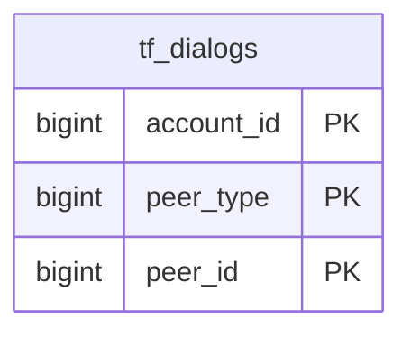
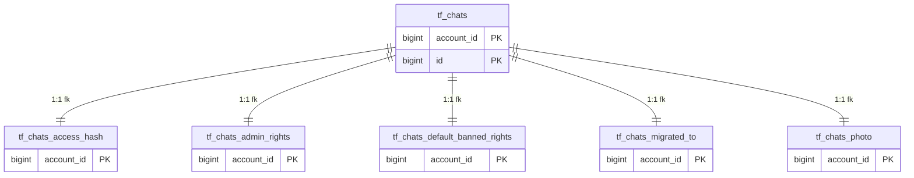

<!-- GENERATED FILE. Do not hand-edit. Run: php bin/generate-relation-graph.php -->
<!-- measured against migration set 4e4b4046795a -->

# Mirror relation graph — measured from the executed DDL

Generated by [`bin/generate-relation-graph.php`](../../bin/generate-relation-graph.php) against migration set `4e4b4046795a`.
Re-run it after any migration; `tests/Schema/RelationGraphIsCurrentTest.php` fails if this file stops matching the schema.

Companion documents: [`model-relation-gap.md`](model-relation-gap.md) (what can be JOINed and what silently
cannot — an analysis, partly stale, honest about its own limits), and
[`mtproto-data-shape-map.md`](mtproto-data-shape-map.md) (method → shape → reference).

## Method — and why it is a script

Every number below was produced by **executing** all 62 shipped migration files in apply order against an in-memory sqlite
connection and reflecting with `PRAGMA table_info` / `PRAGMA foreign_key_list`.
Nothing here transcribes a table shape and nothing here parses PHP.

**A text search cannot produce this document.** Foreign keys reach this schema through shared `Blueprint`
helpers — `linkChild()`, `participantLink()`, `channelUpdateLink()`, `differenceLink()`, `factKey()` — which are
private static methods on the migration classes. `grep "->foreign("` sees only the literal inline declarations
and misses every constraint a helper emits, and it cannot see primary keys or the composite column sets that
decide cardinality. The same blindness applies to counting: `PRAGMA foreign_key_list` emits **one row per column**
of a composite constraint, so counting rows counts columns. This generator groups by constraint `id`.

Scope: what the **migrations** declare. No live database was connected, no `.env` or credential file was read,
no Telegram call was made. A real schema may have drifted in either direction.

## Headline counts

| measure | count |
|---|---|
| migration files executed | 62 |
| tables created, all prefixes | 261 |
| `tf_*` mirror tables | 257 |
| **`tf_*` tables with at least one FOREIGN KEY** | **256** |
| **`tf_*` tables with no FOREIGN KEY at all** | **1** |
| foreign-key constraints declared BY `tf_*` tables (grouped, not per-column) | 460 |
| foreign-key constraints declared by all 261 tables | 461 |
| tables that are children of no other table (`root`) | 4 |
| relations by link kind | fk 257 · soft 0 · root 4 |
| **single-parent relations that are FK-able but carry NO constraint** | **0** |
| relations by cardinality | 1:1 173 · 1:N 84 |
| tables carrying a polymorphic `{base}_type` + `{base}_id` peer pair | 71 |

## What the three link kinds mean

| link | meaning | joinable? | enforced by the database? |
|---|---|---|---|
| `fk` | a FOREIGN KEY constraint exists | yes | **yes** |
| `soft` | child of a `tf_*` parent whose PK covers its own, no FK declared | yes | no — convention only |
| `root` | no parent found | — | — |

A fourth property rides alongside the link, and is NOT a fourth kind: a table with a `{base}_type` +
`{base}_id` sibling pair holds a **polymorphic** reference that resolves across `tf_users` / `tf_chats` /
`tf_channels` on the `_type` int. It is joinable, and no single FOREIGN KEY can constrain it, because one
constraint cannot branch. Those two facts — polymorphic pair present, link kind `soft` or `root` — together
describe the mirror's largest integrity gap, and the graph says so per row rather than in prose.

A `soft` relation is **not** a defect on its own: it is the price of a composite key that the wire scopes per
peer. It is recorded here so that "the mirror must never allow orphan facts" is never read as true by
default. Enforce nothing, and nothing stops an orphan landing.

## Known gaps — `soft 0` does NOT mean "everything is enforced"

**Read the `soft 0` line above as a statement about this generator's classification, not about the
schema's integrity. There are currently 0 single-parent relations that are mechanically FK-able
and carry NO constraint.** They are listed in full below, each with the mechanical reason it is not
constrained.

### WHY THE TWO FIGURES DIFFER — `relationFor()` TAKES THE FIRST FK IT FINDS

This generator derives **one relation per table** (`relationFor()`), and on a table carrying several
constraints it can only report the **first** one. On this tree that first constraint is the tenant FK
to `telegram_accounts`, which is present on all 256 mirror tables — so those tables classify as
`fk` against `telegram_accounts` and their intra-mirror edge is **never examined**. A table with that
tenant FK can therefore never reach the `soft` branch at all:

> `soft` = child of a `{prefix}_…` parent whose primary key covers its own, **and no FK declared at all**.

That last clause is what collapses the figure. `soft 0` means "no table reached that branch, because every
table has an FK somewhere else", NOT "every declared parent link is enforced". The two numbers count
different populations, so they neither agree nor contradict: `soft` is over 261 executed tables and
reports the first FK each one has; the gap figure below is over `MirrorRelationPlan`'s derived intra-mirror
edges and reports the ones with no constraint. **A green suite must not be read as "the mirror has no
unconstrained relation" while this section is non-empty.**

### THE GAP COUNT IS MEASURED, NOT TRANSCRIBED

It comes from `MirrorRelationPlan::singleParent()` — the same class, run against the same in-memory sqlite
connection this script already built above, in the same migration apply order — minus the relations that DO
carry a matching FOREIGN KEY. `singleParent()` is the population whose parent key columns all exist on the
child, i.e. mechanically FK-able today; the subtraction uses the same order-insensitive constraint
predicate as `tests/Schema/Mirror/EveryFkableRelationHasAConstraintTest`. That gate builds its red list from
this same class, so **the figure below and the gate's figure are the same measurement, not two that happen
to agree** — if they ever disagree, one of them has a bug, which is the useful failure.

| measure | count |
|---|---:|
| intra-mirror edges derived from the executed DDL (`singleParent` + `polymorphic` + `unconstrained`) | 207 |
| &nbsp;&nbsp;of which `singleParent` | 198 |
| &nbsp;&nbsp;of which `polymorphic` | 8 |
| &nbsp;&nbsp;of which `unconstrained` | 0 |
| &nbsp;&nbsp;of which `sibling` | 1 |
| **single-parent relations mechanically FK-able and carrying NO constraint** | **0** |
| &nbsp;&nbsp;naming a mechanical reason | 0 |
| &nbsp;&nbsp;with **no** recorded reason — a finding, not a formatting gap | 0 |

None. Every `singleParent` relation carries a real constraint.

## Inbound constraints on the five key entities

| entity | constraints pointing AT it |
|---|---|
| `tf_messages` | 30 |
| `tf_dialogs` | 0 — **none** |
| `tf_users` | 19 |
| `tf_chats` | 5 |
| `tf_channels` | 20 |

## Core families

One `erDiagram` per core family. Edge labels state the cardinality and the link kind, because a bare
mermaid edge hides exactly the distinction this document exists to record.

### `tf_messages` (message — tf_messages plus 30 measured child tables)

```mermaid
erDiagram
    tf_messages {
        bigint account_id "PK"
        bigint peer_type "PK"
        bigint peer_id "PK"
        bigint id "PK"
    }
    tf_messages_edit_date {
        bigint account_id "PK"
    }
    tf_messages_effect {
        bigint account_id "PK"
    }
    tf_messages_entities {
        bigint account_id "PK"
    }
    tf_messages_factcheck {
        bigint account_id "PK"
    }
    tf_messages_forwards {
        bigint account_id "PK"
    }
    tf_messages_from_boosts_applied {
        bigint account_id "PK"
    }
    tf_messages_from_id {
        bigint account_id "PK"
    }
    tf_messages_from_rank {
        bigint account_id "PK"
    }
    tf_messages_fwd_from {
        bigint account_id "PK"
    }
    tf_messages_grouped_id {
        bigint account_id "PK"
    }
    tf_messages_guestchat_via_from {
        bigint account_id "PK"
    }
    tf_messages_media {
        bigint account_id "PK"
    }
    tf_messages_paid_message_stars {
        bigint account_id "PK"
    }
    tf_messages_post_author {
        bigint account_id "PK"
    }
    tf_messages_quick_reply_shortcut_id {
        bigint account_id "PK"
    }
    tf_messages_reactions {
        bigint account_id "PK"
    }
    tf_messages_replies {
        bigint account_id "PK"
    }
    tf_messages_reply_markup {
        bigint account_id "PK"
    }
    tf_messages_reply_to {
        bigint account_id "PK"
    }
    tf_messages_report_delivery_until_date {
        bigint account_id "PK"
    }
    tf_messages_restriction_reason {
        bigint account_id "PK"
    }
    tf_messages_rich_message {
        bigint account_id "PK"
    }
    tf_messages_saved_peer_id {
        bigint account_id "PK"
    }
    tf_messages_schedule_repeat_period {
        bigint account_id "PK"
    }
    tf_messages_suggested_post {
        bigint account_id "PK"
    }
    tf_messages_summary_from_language {
        bigint account_id "PK"
    }
    tf_messages_ttl_period {
        bigint account_id "PK"
    }
    tf_messages_via_bot_id {
        bigint account_id "PK"
    }
    tf_messages_via_business_bot_id {
        bigint account_id "PK"
    }
    tf_messages_views {
        bigint account_id "PK"
    }
    tf_messages ||--|| tf_messages_edit_date : "1:1 fk"
    tf_messages ||--|| tf_messages_effect : "1:1 fk"
    tf_messages ||--o{ tf_messages_entities : "1:N fk"
    tf_messages ||--|| tf_messages_factcheck : "1:1 fk"
    tf_messages ||--|| tf_messages_forwards : "1:1 fk"
    tf_messages ||--|| tf_messages_from_boosts_applied : "1:1 fk"
    tf_messages ||--|| tf_messages_from_id : "1:1 fk"
    tf_messages ||--|| tf_messages_from_rank : "1:1 fk"
    tf_messages ||--|| tf_messages_fwd_from : "1:1 fk"
    tf_messages ||--|| tf_messages_grouped_id : "1:1 fk"
    tf_messages ||--|| tf_messages_guestchat_via_from : "1:1 fk"
    tf_messages ||--|| tf_messages_media : "1:1 fk"
    tf_messages ||--|| tf_messages_paid_message_stars : "1:1 fk"
    tf_messages ||--|| tf_messages_post_author : "1:1 fk"
    tf_messages ||--|| tf_messages_quick_reply_shortcut_id : "1:1 fk"
    tf_messages ||--|| tf_messages_reactions : "1:1 fk"
    tf_messages ||--|| tf_messages_replies : "1:1 fk"
    tf_messages ||--|| tf_messages_reply_markup : "1:1 fk"
    tf_messages ||--|| tf_messages_reply_to : "1:1 fk"
    tf_messages ||--|| tf_messages_report_delivery_until_date : "1:1 fk"
    tf_messages ||--o{ tf_messages_restriction_reason : "1:N fk"
    tf_messages ||--|| tf_messages_rich_message : "1:1 fk"
    tf_messages ||--|| tf_messages_saved_peer_id : "1:1 fk"
    tf_messages ||--|| tf_messages_schedule_repeat_period : "1:1 fk"
    tf_messages ||--|| tf_messages_suggested_post : "1:1 fk"
    tf_messages ||--|| tf_messages_summary_from_language : "1:1 fk"
    tf_messages ||--|| tf_messages_ttl_period : "1:1 fk"
    tf_messages ||--|| tf_messages_via_bot_id : "1:1 fk"
    tf_messages ||--|| tf_messages_via_business_bot_id : "1:1 fk"
    tf_messages ||--|| tf_messages_views : "1:1 fk"
```

Edge labels: the cardinality, then the link kind. `fk` = a FOREIGN KEY constraint exists and the
database enforces it. `soft` = this parent's PK covers the child's and no constraint declares the link,
so it is joinable and unenforced. A bare diagram would hide exactly that difference, which is the
difference this document exists to record.

### `tf_dialogs` (dialog — tf_dialogs plus 0 measured child tables)

Edge labels: the cardinality, then the link kind. `fk` = a FOREIGN KEY constraint exists and the
database enforces it. `soft` = this parent's PK covers the child's and no constraint declares the link,
so it is joinable and unenforced. A bare diagram would hide exactly that difference, which is the
difference this document exists to record.

### `tf_users` (user — tf_users plus 19 measured child tables)

```mermaid
erDiagram
    tf_users {
        bigint account_id "PK"
        bigint id "PK"
    }
    tf_users_access_hash {
        bigint account_id "PK"
    }
    tf_users_bot_active_users {
        bigint account_id "PK"
    }
    tf_users_bot_info_version {
        bigint account_id "PK"
    }
    tf_users_bot_inline_placeholder {
        bigint account_id "PK"
    }
    tf_users_bot_verification_icon {
        bigint account_id "PK"
    }
    tf_users_color {
        bigint account_id "PK"
    }
    tf_users_emoji_status {
        bigint account_id "PK"
    }
    tf_users_first_name {
        bigint account_id "PK"
    }
    tf_users_lang_code {
        bigint account_id "PK"
    }
    tf_users_last_name {
        bigint account_id "PK"
    }
    tf_users_phone {
        bigint account_id "PK"
    }
    tf_users_photo {
        bigint account_id "PK"
    }
    tf_users_profile_color {
        bigint account_id "PK"
    }
    tf_users_restriction_reason {
        bigint account_id "PK"
    }
    tf_users_send_paid_messages_stars {
        bigint account_id "PK"
    }
    tf_users_status {
        bigint account_id "PK"
    }
    tf_users_stories_max_id {
        bigint account_id "PK"
    }
    tf_users_username {
        bigint account_id "PK"
    }
    tf_users_usernames {
        bigint account_id "PK"
    }
    tf_users ||--|| tf_users_access_hash : "1:1 fk"
    tf_users ||--|| tf_users_bot_active_users : "1:1 fk"
    tf_users ||--|| tf_users_bot_info_version : "1:1 fk"
    tf_users ||--|| tf_users_bot_inline_placeholder : "1:1 fk"
    tf_users ||--|| tf_users_bot_verification_icon : "1:1 fk"
    tf_users ||--|| tf_users_color : "1:1 fk"
    tf_users ||--|| tf_users_emoji_status : "1:1 fk"
    tf_users ||--|| tf_users_first_name : "1:1 fk"
    tf_users ||--|| tf_users_lang_code : "1:1 fk"
    tf_users ||--|| tf_users_last_name : "1:1 fk"
    tf_users ||--|| tf_users_phone : "1:1 fk"
    tf_users ||--|| tf_users_photo : "1:1 fk"
    tf_users ||--|| tf_users_profile_color : "1:1 fk"
    tf_users ||--o{ tf_users_restriction_reason : "1:N fk"
    tf_users ||--|| tf_users_send_paid_messages_stars : "1:1 fk"
    tf_users ||--|| tf_users_status : "1:1 fk"
    tf_users ||--|| tf_users_stories_max_id : "1:1 fk"
    tf_users ||--|| tf_users_username : "1:1 fk"
    tf_users ||--o{ tf_users_usernames : "1:N fk"
```

Edge labels: the cardinality, then the link kind. `fk` = a FOREIGN KEY constraint exists and the
database enforces it. `soft` = this parent's PK covers the child's and no constraint declares the link,
so it is joinable and unenforced. A bare diagram would hide exactly that difference, which is the
difference this document exists to record.

### `tf_chats` (chat — tf_chats plus 5 measured child tables)

Edge labels: the cardinality, then the link kind. `fk` = a FOREIGN KEY constraint exists and the
database enforces it. `soft` = this parent's PK covers the child's and no constraint declares the link,
so it is joinable and unenforced. A bare diagram would hide exactly that difference, which is the
difference this document exists to record.

### `tf_channels` (channel — tf_channels plus 20 measured child tables)

```mermaid
erDiagram
    tf_channels {
        bigint account_id "PK"
        bigint id "PK"
    }
    tf_channel_participants {
        bigint account_id "PK"
    }
    tf_channel_updates {
        bigint account_id "PK"
    }
    tf_channels_admin_rights {
        bigint account_id "PK"
    }
    tf_channels_banned_rights {
        bigint account_id "PK"
    }
    tf_channels_bot_verification_icon {
        bigint account_id "PK"
    }
    tf_channels_color {
        bigint account_id "PK"
    }
    tf_channels_default_banned_rights {
        bigint account_id "PK"
    }
    tf_channels_emoji_status {
        bigint account_id "PK"
    }
    tf_channels_level {
        bigint account_id "PK"
    }
    tf_channels_linked_monoforum_id {
        bigint account_id "PK"
    }
    tf_channels_participants_count {
        bigint account_id "PK"
    }
    tf_channels_photo {
        bigint account_id "PK"
    }
    tf_channels_profile_color {
        bigint account_id "PK"
    }
    tf_channels_restriction_reason {
        bigint account_id "PK"
    }
    tf_channels_send_paid_messages_stars {
        bigint account_id "PK"
    }
    tf_channels_stories_max_id {
        bigint account_id "PK"
    }
    tf_channels_subscription_until_date {
        bigint account_id "PK"
    }
    tf_channels_until_date {
        bigint account_id "PK"
    }
    tf_channels_username {
        bigint account_id "PK"
    }
    tf_channels_usernames {
        bigint account_id "PK"
    }
    tf_channels ||--o{ tf_channel_participants : "1:N fk"
    tf_channels ||--o{ tf_channel_updates : "1:N fk"
    tf_channels ||--|| tf_channels_admin_rights : "1:1 fk"
    tf_channels ||--|| tf_channels_banned_rights : "1:1 fk"
    tf_channels ||--|| tf_channels_bot_verification_icon : "1:1 fk"
    tf_channels ||--|| tf_channels_color : "1:1 fk"
    tf_channels ||--|| tf_channels_default_banned_rights : "1:1 fk"
    tf_channels ||--|| tf_channels_emoji_status : "1:1 fk"
    tf_channels ||--|| tf_channels_level : "1:1 fk"
    tf_channels ||--|| tf_channels_linked_monoforum_id : "1:1 fk"
    tf_channels ||--|| tf_channels_participants_count : "1:1 fk"
    tf_channels ||--|| tf_channels_photo : "1:1 fk"
    tf_channels ||--|| tf_channels_profile_color : "1:1 fk"
    tf_channels ||--o{ tf_channels_restriction_reason : "1:N fk"
    tf_channels ||--|| tf_channels_send_paid_messages_stars : "1:1 fk"
    tf_channels ||--|| tf_channels_stories_max_id : "1:1 fk"
    tf_channels ||--|| tf_channels_subscription_until_date : "1:1 fk"
    tf_channels ||--|| tf_channels_until_date : "1:1 fk"
    tf_channels ||--|| tf_channels_username : "1:1 fk"
    tf_channels ||--o{ tf_channels_usernames : "1:N fk"
```

Edge labels: the cardinality, then the link kind. `fk` = a FOREIGN KEY constraint exists and the
database enforces it. `soft` = this parent's PK covers the child's and no constraint declares the link,
so it is joinable and unenforced. A bare diagram would hide exactly that difference, which is the
difference this document exists to record.

## The full graph, one row per table

`join` is the child-side column set: for `fk` rows the constraint's own columns, otherwise the child
primary key. `polymorphic` marks a table that ALSO holds a `{base}_type` + `{base}_id` peer pair — it is an
attribute of the row, not a different kind of parent link.

<!-- BEGIN GENERATED TABLE GRAPH -->

| # | table | parent | join | cardinality | link | polymorphic | pk cols |
|---|---|---|---|---|---|---|---|
| 1 | `telegram_accounts` | `telegram_apps` | `app_id` | 1:N | `fk` | yes — `owner_type` / `owner_id` | `id` |
| 2 | `telegram_apps` | — | `id` | — | `root` | yes — `owner_type` / `owner_id` | `id` |
| 3 | `tf_accounts` | — | `id` | — | `root` | no | `id` |
| 4 | `tf_admin_log_events` | `telegram_accounts` | `account_id` | 1:N | `fk` | no | `account_id`, `id` |
| 5 | `tf_admin_log_events_action` | `tf_admin_log_events` | `account_id`, `id` | 1:1 | `fk` | no | `account_id`, `id` |
| 6 | `tf_attach_menu_bots` | `telegram_accounts` | `account_id` | 1:N | `fk` | no | `account_id`, `bot_id` |
| 7 | `tf_attach_menu_bots_icons` | `tf_attach_menu_bots` | `account_id`, `bot_id` | 1:N | `fk` | no | `account_id`, `bot_id`, `position` |
| 8 | `tf_attach_menu_bots_peer_types` | `tf_attach_menu_bots` | `account_id`, `bot_id` | 1:N | `fk` | no | `account_id`, `bot_id`, `position` |
| 9 | `tf_backfill_cursors` | `telegram_accounts` | `account_id` | 1:N | `fk` | no | `id` |
| 10 | `tf_bot_apps` | `telegram_accounts` | `account_id` | 1:N | `fk` | no | `account_id`, `id` |
| 11 | `tf_bot_apps_document` | `tf_bot_apps` | `account_id`, `id` | 1:1 | `fk` | no | `account_id`, `id` |
| 12 | `tf_bot_apps_photo` | `tf_bot_apps` | `account_id`, `id` | 1:1 | `fk` | no | `account_id`, `id` |
| 13 | `tf_bot_infos` | `telegram_accounts` | `account_id` | 1:N | `fk` | no | `account_id`, `id` |
| 14 | `tf_bot_infos_app_settings` | `tf_bot_infos` | `account_id`, `id` | 1:1 | `fk` | no | `account_id`, `id` |
| 15 | `tf_bot_infos_commands` | `tf_bot_infos` | `account_id`, `id` | 1:N | `fk` | no | `account_id`, `id`, `position` |
| 16 | `tf_bot_infos_description_document` | `tf_bot_infos` | `account_id`, `id` | 1:1 | `fk` | no | `account_id`, `id` |
| 17 | `tf_bot_infos_description_photo` | `tf_bot_infos` | `account_id`, `id` | 1:1 | `fk` | no | `account_id`, `id` |
| 18 | `tf_bot_infos_menu_button` | `tf_bot_infos` | `account_id`, `id` | 1:1 | `fk` | no | `account_id`, `id` |
| 19 | `tf_bot_infos_privacy_policy_url` | `tf_bot_infos` | `account_id`, `id` | 1:1 | `fk` | no | `account_id`, `id` |
| 20 | `tf_bot_infos_user_id` | `tf_bot_infos` | `account_id`, `id` | 1:1 | `fk` | no | `account_id`, `id` |
| 21 | `tf_bot_infos_verifier_settings` | `tf_bot_infos` | `account_id`, `id` | 1:1 | `fk` | no | `account_id`, `id` |
| 22 | `tf_bot_inline_results` | `telegram_accounts` | `account_id` | 1:N | `fk` | no | `account_id`, `id` |
| 23 | `tf_bot_inline_results_content` | `tf_bot_inline_results` | `account_id`, `id` | 1:1 | `fk` | no | `account_id`, `id` |
| 24 | `tf_bot_inline_results_description` | `tf_bot_inline_results` | `account_id`, `id` | 1:1 | `fk` | no | `account_id`, `id` |
| 25 | `tf_bot_inline_results_send_message` | `tf_bot_inline_results` | `account_id`, `id` | 1:1 | `fk` | yes — `venue_type` / `venue_id` | `account_id`, `id` |
| 26 | `tf_bot_inline_results_thumb` | `tf_bot_inline_results` | `account_id`, `id` | 1:1 | `fk` | no | `account_id`, `id` |
| 27 | `tf_bot_inline_results_title` | `tf_bot_inline_results` | `account_id`, `id` | 1:1 | `fk` | no | `account_id`, `id` |
| 28 | `tf_bot_inline_results_url` | `tf_bot_inline_results` | `account_id`, `id` | 1:1 | `fk` | no | `account_id`, `id` |
| 29 | `tf_business_chat_links` | `telegram_accounts` | `account_id` | 1:N | `fk` | no | `account_id`, `link` |
| 30 | `tf_business_chat_links_entities` | `tf_business_chat_links` | `account_id`, `link` | 1:N | `fk` | no | `account_id`, `link`, `position` |
| 31 | `tf_business_chat_links_title` | `tf_business_chat_links` | `account_id`, `link` | 1:1 | `fk` | no | `account_id`, `link` |
| 32 | `tf_channel_participants` | `tf_channels` | `account_id`, `channel_id` | 1:N | `fk` | no | `account_id`, `channel_id`, `user_id` |
| 33 | `tf_channel_participants_peer` | `tf_channel_participants` | `account_id`, `channel_id`, `user_id` | 1:1 | `fk` | yes — `peer_type` / `peer_id` | `account_id`, `channel_id`, `user_id` |
| 34 | `tf_channel_participants_rank` | `tf_channel_participants` | `account_id`, `channel_id`, `user_id` | 1:1 | `fk` | no | `account_id`, `channel_id`, `user_id` |
| 35 | `tf_channel_participants_subscription_until_date` | `tf_channel_participants` | `account_id`, `channel_id`, `user_id` | 1:1 | `fk` | no | `account_id`, `channel_id`, `user_id` |
| 36 | `tf_channel_updates` | `tf_channels` | `account_id`, `channel_id` | 1:N | `fk` | no | `account_id`, `channel_id`, `position` |
| 37 | `tf_channel_updates_dialog` | `tf_channel_updates` | `account_id`, `channel_id`, `position` | 1:1 | `fk` | yes — `peer_type` / `peer_id` | `account_id`, `channel_id`, `position` |
| 38 | `tf_channel_updates_pts` | `tf_channel_updates` | `account_id`, `channel_id`, `position` | 1:1 | `fk` | no | `account_id`, `channel_id`, `position` |
| 39 | `tf_channel_updates_timeout` | `tf_channel_updates` | `account_id`, `channel_id`, `position` | 1:1 | `fk` | no | `account_id`, `channel_id`, `position` |
| 40 | `tf_channels` | `telegram_accounts` | `account_id` | 1:N | `fk` | no | `account_id`, `id` |
| 41 | `tf_channels_admin_rights` | `tf_channels` | `account_id`, `id` | 1:1 | `fk` | no | `account_id`, `id` |
| 42 | `tf_channels_banned_rights` | `tf_channels` | `account_id`, `id` | 1:1 | `fk` | no | `account_id`, `id` |
| 43 | `tf_channels_bot_verification_icon` | `tf_channels` | `account_id`, `id` | 1:1 | `fk` | no | `account_id`, `id` |
| 44 | `tf_channels_color` | `tf_channels` | `account_id`, `id` | 1:1 | `fk` | no | `account_id`, `id` |
| 45 | `tf_channels_default_banned_rights` | `tf_channels` | `account_id`, `id` | 1:1 | `fk` | no | `account_id`, `id` |
| 46 | `tf_channels_emoji_status` | `tf_channels` | `account_id`, `id` | 1:1 | `fk` | no | `account_id`, `id` |
| 47 | `tf_channels_level` | `tf_channels` | `account_id`, `id` | 1:1 | `fk` | no | `account_id`, `id` |
| 48 | `tf_channels_linked_monoforum_id` | `tf_channels` | `account_id`, `id` | 1:1 | `fk` | no | `account_id`, `id` |
| 49 | `tf_channels_participants_count` | `tf_channels` | `account_id`, `id` | 1:1 | `fk` | no | `account_id`, `id` |
| 50 | `tf_channels_photo` | `tf_channels` | `account_id`, `id` | 1:1 | `fk` | no | `account_id`, `id` |
| 51 | `tf_channels_profile_color` | `tf_channels` | `account_id`, `id` | 1:1 | `fk` | no | `account_id`, `id` |
| 52 | `tf_channels_restriction_reason` | `tf_channels` | `account_id`, `id` | 1:N | `fk` | no | `account_id`, `id`, `position` |
| 53 | `tf_channels_send_paid_messages_stars` | `tf_channels` | `account_id`, `id` | 1:1 | `fk` | no | `account_id`, `id` |
| 54 | `tf_channels_stories_max_id` | `tf_channels` | `account_id`, `id` | 1:1 | `fk` | no | `account_id`, `id` |
| 55 | `tf_channels_subscription_until_date` | `tf_channels` | `account_id`, `id` | 1:1 | `fk` | no | `account_id`, `id` |
| 56 | `tf_channels_until_date` | `tf_channels` | `account_id`, `id` | 1:1 | `fk` | no | `account_id`, `id` |
| 57 | `tf_channels_username` | `tf_channels` | `account_id`, `id` | 1:1 | `fk` | no | `account_id`, `id` |
| 58 | `tf_channels_usernames` | `tf_channels` | `account_id`, `id` | 1:N | `fk` | no | `account_id`, `id`, `position` |
| 59 | `tf_chats` | `telegram_accounts` | `account_id` | 1:N | `fk` | no | `account_id`, `id` |
| 60 | `tf_chats_access_hash` | `tf_chats` | `account_id`, `id` | 1:1 | `fk` | no | `account_id`, `id` |
| 61 | `tf_chats_admin_rights` | `tf_chats` | `account_id`, `id` | 1:1 | `fk` | no | `account_id`, `id` |
| 62 | `tf_chats_default_banned_rights` | `tf_chats` | `account_id`, `id` | 1:1 | `fk` | no | `account_id`, `id` |
| 63 | `tf_chats_migrated_to` | `tf_chats` | `account_id`, `id` | 1:1 | `fk` | yes — `peer_type` / `peer_id` | `account_id`, `id` |
| 64 | `tf_chats_photo` | `tf_chats` | `account_id`, `id` | 1:1 | `fk` | no | `account_id`, `id` |
| 65 | `tf_dialog_filters` | `telegram_accounts` | `account_id` | 1:N | `fk` | no | `account_id`, `id` |
| 66 | `tf_dialog_filters_color` | `tf_dialog_filters` | `account_id`, `id` | 1:1 | `fk` | no | `account_id`, `id` |
| 67 | `tf_dialog_filters_emoticon` | `tf_dialog_filters` | `account_id`, `id` | 1:1 | `fk` | no | `account_id`, `id` |
| 68 | `tf_dialog_filters_exclude_peers` | `tf_dialog_filters` | `account_id`, `id` | 1:N | `fk` | no | `account_id`, `id`, `position` |
| 69 | `tf_dialog_filters_include_peers` | `tf_dialog_filters` | `account_id`, `id` | 1:N | `fk` | no | `account_id`, `id`, `position` |
| 70 | `tf_dialog_filters_pinned_peers` | `tf_dialog_filters` | `account_id`, `id` | 1:N | `fk` | no | `account_id`, `id`, `position` |
| 71 | `tf_dialog_filters_title` | `tf_dialog_filters` | `account_id`, `id` | 1:1 | `fk` | no | `account_id`, `id` |
| 72 | `tf_dialog_filters_title_entities` | `tf_dialog_filters_title` | `account_id`, `id` | 1:N | `fk` | no | `account_id`, `id`, `position` |
| 73 | `tf_dialogs` | `telegram_accounts` | `account_id` | 1:N | `fk` | yes — `peer_type` / `peer_id` | `account_id`, `peer_type`, `peer_id` |
| 74 | `tf_dialogs_draft` | `telegram_accounts` | `account_id` | 1:N | `fk` | yes — `peer_type` / `peer_id` | `account_id`, `peer_type`, `peer_id` |
| 75 | `tf_dialogs_folder` | `telegram_accounts` | `account_id` | 1:N | `fk` | yes — `peer_type` / `peer_id` | `account_id`, `peer_type`, `peer_id` |
| 76 | `tf_dialogs_folder_id` | `telegram_accounts` | `account_id` | 1:N | `fk` | yes — `peer_type` / `peer_id` | `account_id`, `peer_type`, `peer_id` |
| 77 | `tf_dialogs_notify_settings` | `telegram_accounts` | `account_id` | 1:N | `fk` | yes — `peer_type` / `peer_id` | `account_id`, `peer_type`, `peer_id` |
| 78 | `tf_dialogs_pts` | `telegram_accounts` | `account_id` | 1:N | `fk` | yes — `peer_type` / `peer_id` | `account_id`, `peer_type`, `peer_id` |
| 79 | `tf_dialogs_ttl_period` | `telegram_accounts` | `account_id` | 1:N | `fk` | yes — `peer_type` / `peer_id` | `account_id`, `peer_type`, `peer_id` |
| 80 | `tf_documents` | `telegram_accounts` | `account_id` | 1:N | `fk` | no | `account_id`, `id` |
| 81 | `tf_documents_attributes` | `tf_documents` | `account_id`, `id` | 1:N | `fk` | no | `account_id`, `id`, `position` |
| 82 | `tf_documents_thumbs` | `tf_documents` | `account_id`, `id` | 1:N | `fk` | no | `account_id`, `id`, `position` |
| 83 | `tf_documents_video_thumbs` | `tf_documents` | `account_id`, `id` | 1:N | `fk` | no | `account_id`, `id`, `position` |
| 84 | `tf_encrypted_chats` | `telegram_accounts` | `account_id` | 1:N | `fk` | no | `account_id`, `id` |
| 85 | `tf_folders` | `telegram_accounts` | `account_id` | 1:N | `fk` | no | `account_id`, `id` |
| 86 | `tf_folders_photo` | `tf_folders` | `account_id`, `id` | 1:1 | `fk` | no | `account_id`, `id` |
| 87 | `tf_forum_topics` | `telegram_accounts` | `account_id` | 1:N | `fk` | no | `account_id`, `id` |
| 88 | `tf_group_calls` | `telegram_accounts` | `account_id` | 1:N | `fk` | no | `account_id`, `id` |
| 89 | `tf_ingest_clues` | `telegram_accounts` | `account_id` | 1:N | `fk` | no | **none** |
| 90 | `tf_message_actions` | `telegram_accounts` | `account_id` | 1:N | `fk` | yes — `peer_type` / `peer_id` | `account_id`, `peer_type`, `peer_id`, `message_action_id` |
| 91 | `tf_message_actions_users` | `telegram_accounts` | `account_id` | 1:N | `fk` | yes — `peer_type` / `peer_id` | `account_id`, `peer_type`, `peer_id`, `message_action_id`, `position` |
| 92 | `tf_message_medias` | `telegram_accounts` | `account_id` | 1:N | `fk` | yes — `peer_type` / `peer_id` | `account_id`, `peer_type`, `peer_id`, `message_media_id` |
| 93 | `tf_message_medias_ttl_seconds` | `telegram_accounts` | `account_id` | 1:N | `fk` | yes — `peer_type` / `peer_id` | `account_id`, `peer_type`, `peer_id`, `message_media_id` |
| 94 | `tf_message_search` | `telegram_accounts` | `account_id` | 1:N | `fk` | yes — `peer_type` / `peer_id` | `account_id`, `token`, `peer_type`, `peer_id`, `id` |
| 95 | `tf_messages` | `telegram_accounts` | `account_id` | 1:N | `fk` | yes — `peer_type` / `peer_id` | `account_id`, `peer_type`, `peer_id`, `id` |
| 96 | `tf_messages_edit_date` | `tf_messages` | `account_id`, `peer_type`, `peer_id`, `id` | 1:1 | `fk` | yes — `peer_type` / `peer_id` | `account_id`, `peer_type`, `peer_id`, `id` |
| 97 | `tf_messages_effect` | `tf_messages` | `account_id`, `peer_type`, `peer_id`, `id` | 1:1 | `fk` | yes — `peer_type` / `peer_id` | `account_id`, `peer_type`, `peer_id`, `id` |
| 98 | `tf_messages_entities` | `tf_messages` | `account_id`, `peer_type`, `peer_id`, `id` | 1:N | `fk` | yes — `peer_type` / `peer_id` | `account_id`, `peer_type`, `peer_id`, `id`, `position` |
| 99 | `tf_messages_factcheck` | `tf_messages` | `account_id`, `peer_type`, `peer_id`, `id` | 1:1 | `fk` | yes — `peer_type` / `peer_id` | `account_id`, `peer_type`, `peer_id`, `id` |
| 100 | `tf_messages_forwards` | `tf_messages` | `account_id`, `peer_type`, `peer_id`, `id` | 1:1 | `fk` | yes — `peer_type` / `peer_id` | `account_id`, `peer_type`, `peer_id`, `id` |
| 101 | `tf_messages_from_boosts_applied` | `tf_messages` | `account_id`, `peer_type`, `peer_id`, `id` | 1:1 | `fk` | yes — `peer_type` / `peer_id` | `account_id`, `peer_type`, `peer_id`, `id` |
| 102 | `tf_messages_from_id` | `tf_messages` | `account_id`, `peer_type`, `peer_id`, `id` | 1:1 | `fk` | yes — `from_id_type` / `from_id_id` | `account_id`, `peer_type`, `peer_id`, `id` |
| 103 | `tf_messages_from_rank` | `tf_messages` | `account_id`, `peer_type`, `peer_id`, `id` | 1:1 | `fk` | yes — `peer_type` / `peer_id` | `account_id`, `peer_type`, `peer_id`, `id` |
| 104 | `tf_messages_fwd_from` | `tf_messages` | `account_id`, `peer_type`, `peer_id`, `id` | 1:1 | `fk` | yes — `saved_from_peer_type` / `saved_from_peer_id` | `account_id`, `peer_type`, `peer_id`, `id` |
| 105 | `tf_messages_grouped_id` | `tf_messages` | `account_id`, `peer_type`, `peer_id`, `id` | 1:1 | `fk` | yes — `peer_type` / `peer_id` | `account_id`, `peer_type`, `peer_id`, `id` |
| 106 | `tf_messages_guestchat_via_from` | `tf_messages` | `account_id`, `peer_type`, `peer_id`, `id` | 1:1 | `fk` | yes — `guestchat_via_from_type` / `guestchat_via_from_id` | `account_id`, `peer_type`, `peer_id`, `id` |
| 107 | `tf_messages_media` | `tf_messages` | `account_id`, `message_peer_type`, `message_peer_id`, `id` | 1:1 | `fk` | yes — `message_peer_type` / `message_peer_id` | `account_id`, `message_peer_type`, `message_peer_id`, `id` |
| 108 | `tf_messages_paid_message_stars` | `tf_messages` | `account_id`, `peer_type`, `peer_id`, `id` | 1:1 | `fk` | yes — `peer_type` / `peer_id` | `account_id`, `peer_type`, `peer_id`, `id` |
| 109 | `tf_messages_post_author` | `tf_messages` | `account_id`, `peer_type`, `peer_id`, `id` | 1:1 | `fk` | yes — `peer_type` / `peer_id` | `account_id`, `peer_type`, `peer_id`, `id` |
| 110 | `tf_messages_quick_reply_shortcut_id` | `tf_messages` | `account_id`, `peer_type`, `peer_id`, `id` | 1:1 | `fk` | yes — `peer_type` / `peer_id` | `account_id`, `peer_type`, `peer_id`, `id` |
| 111 | `tf_messages_reactions` | `tf_messages` | `account_id`, `peer_type`, `peer_id`, `id` | 1:1 | `fk` | yes — `peer_type` / `peer_id` | `account_id`, `peer_type`, `peer_id`, `id` |
| 112 | `tf_messages_replies` | `tf_messages` | `account_id`, `peer_type`, `peer_id`, `id` | 1:1 | `fk` | yes — `recent_repliers_type` / `recent_repliers_id` | `account_id`, `peer_type`, `peer_id`, `id` |
| 113 | `tf_messages_reply_markup` | `tf_messages` | `account_id`, `peer_type`, `peer_id`, `id` | 1:1 | `fk` | yes — `peer_type` / `peer_id` | `account_id`, `peer_type`, `peer_id`, `id` |
| 114 | `tf_messages_reply_markup_rows` | `tf_messages_reply_markup` | `account_id`, `peer_type`, `peer_id`, `id` | 1:N | `fk` | yes — `peer_type` / `peer_id` | `account_id`, `peer_type`, `peer_id`, `id`, `position` |
| 115 | `tf_messages_reply_markup_rows_buttons` | `tf_messages_reply_markup_rows` | `account_id`, `peer_type`, `peer_id`, `id`, `parent_position` | 1:N | `fk` | yes — `peer_type` / `peer_id` | `account_id`, `peer_type`, `peer_id`, `id`, `position`, `parent_position` |
| 116 | `tf_messages_reply_to` | `tf_messages` | `account_id`, `peer_type`, `peer_id`, `id` | 1:1 | `fk` | yes — `reply_to_peer_id_type` / `reply_to_peer_id_id` | `account_id`, `peer_type`, `peer_id`, `id` |
| 117 | `tf_messages_report_delivery_until_date` | `tf_messages` | `account_id`, `peer_type`, `peer_id`, `id` | 1:1 | `fk` | yes — `peer_type` / `peer_id` | `account_id`, `peer_type`, `peer_id`, `id` |
| 118 | `tf_messages_restriction_reason` | `tf_messages` | `account_id`, `peer_type`, `peer_id`, `id` | 1:N | `fk` | yes — `peer_type` / `peer_id` | `account_id`, `peer_type`, `peer_id`, `id`, `position` |
| 119 | `tf_messages_rich_message` | `tf_messages` | `account_id`, `peer_type`, `peer_id`, `id` | 1:1 | `fk` | yes — `peer_type` / `peer_id` | `account_id`, `peer_type`, `peer_id`, `id` |
| 120 | `tf_messages_saved_peer_id` | `tf_messages` | `account_id`, `peer_type`, `peer_id`, `id` | 1:1 | `fk` | yes — `saved_peer_id_type` / `saved_peer_id_id` | `account_id`, `peer_type`, `peer_id`, `id` |
| 121 | `tf_messages_schedule_repeat_period` | `tf_messages` | `account_id`, `peer_type`, `peer_id`, `id` | 1:1 | `fk` | yes — `peer_type` / `peer_id` | `account_id`, `peer_type`, `peer_id`, `id` |
| 122 | `tf_messages_service` | `telegram_accounts` | `account_id` | 1:N | `fk` | yes — `peer_type` / `peer_id` | `account_id`, `peer_type`, `peer_id`, `id` |
| 123 | `tf_messages_service_action` | `tf_messages_service` | `account_id`, `peer_type`, `peer_id`, `id` | 1:1 | `fk` | yes — `boost_peer_type` / `boost_peer_id` | `account_id`, `peer_type`, `peer_id`, `id` |
| 124 | `tf_messages_service_from_id` | `tf_messages_service` | `account_id`, `peer_type`, `peer_id`, `id` | 1:1 | `fk` | yes — `from_id_type` / `from_id_id` | `account_id`, `peer_type`, `peer_id`, `id` |
| 125 | `tf_messages_service_reactions` | `tf_messages_service` | `account_id`, `peer_type`, `peer_id`, `id` | 1:1 | `fk` | yes — `peer_type` / `peer_id` | `account_id`, `peer_type`, `peer_id`, `id` |
| 126 | `tf_messages_service_reply_to` | `tf_messages_service` | `account_id`, `peer_type`, `peer_id`, `id` | 1:1 | `fk` | yes — `reply_to_peer_id_type` / `reply_to_peer_id_id` | `account_id`, `peer_type`, `peer_id`, `id` |
| 127 | `tf_messages_service_saved_peer_id` | `tf_messages_service` | `account_id`, `peer_type`, `peer_id`, `id` | 1:1 | `fk` | yes — `saved_peer_id_type` / `saved_peer_id_id` | `account_id`, `peer_type`, `peer_id`, `id` |
| 128 | `tf_messages_service_ttl_period` | `tf_messages_service` | `account_id`, `peer_type`, `peer_id`, `id` | 1:1 | `fk` | yes — `peer_type` / `peer_id` | `account_id`, `peer_type`, `peer_id`, `id` |
| 129 | `tf_messages_suggested_post` | `tf_messages` | `account_id`, `peer_type`, `peer_id`, `id` | 1:1 | `fk` | yes — `peer_type` / `peer_id` | `account_id`, `peer_type`, `peer_id`, `id` |
| 130 | `tf_messages_summary_from_language` | `tf_messages` | `account_id`, `peer_type`, `peer_id`, `id` | 1:1 | `fk` | yes — `peer_type` / `peer_id` | `account_id`, `peer_type`, `peer_id`, `id` |
| 131 | `tf_messages_ttl_period` | `tf_messages` | `account_id`, `peer_type`, `peer_id`, `id` | 1:1 | `fk` | yes — `peer_type` / `peer_id` | `account_id`, `peer_type`, `peer_id`, `id` |
| 132 | `tf_messages_via_bot_id` | `tf_messages` | `account_id`, `peer_type`, `peer_id`, `id` | 1:1 | `fk` | yes — `peer_type` / `peer_id` | `account_id`, `peer_type`, `peer_id`, `id` |
| 133 | `tf_messages_via_business_bot_id` | `tf_messages` | `account_id`, `peer_type`, `peer_id`, `id` | 1:1 | `fk` | yes — `peer_type` / `peer_id` | `account_id`, `peer_type`, `peer_id`, `id` |
| 134 | `tf_messages_views` | `tf_messages` | `account_id`, `peer_type`, `peer_id`, `id` | 1:1 | `fk` | yes — `peer_type` / `peer_id` | `account_id`, `peer_type`, `peer_id`, `id` |
| 135 | `tf_phone_calls` | `telegram_accounts` | `account_id` | 1:N | `fk` | no | `account_id`, `id` |
| 136 | `tf_phone_calls_protocol` | `tf_phone_calls` | `account_id`, `id` | 1:1 | `fk` | no | `account_id`, `id` |
| 137 | `tf_phone_calls_receive_date` | `tf_phone_calls` | `account_id`, `id` | 1:1 | `fk` | no | `account_id`, `id` |
| 138 | `tf_photos` | `telegram_accounts` | `account_id` | 1:N | `fk` | no | `account_id`, `id` |
| 139 | `tf_photos_sizes` | `tf_photos` | `account_id`, `id` | 1:N | `fk` | no | `account_id`, `id`, `position` |
| 140 | `tf_photos_video_sizes` | `tf_photos` | `account_id`, `id` | 1:N | `fk` | no | `account_id`, `id`, `position` |
| 141 | `tf_quick_replies` | `telegram_accounts` | `account_id` | 1:N | `fk` | no | `account_id`, `shortcut_id` |
| 142 | `tf_reactions` | `telegram_accounts` | `account_id` | 1:N | `fk` | no | `account_id`, `reaction_id` |
| 143 | `tf_saved_dialogs` | `telegram_accounts` | `account_id` | 1:N | `fk` | yes — `peer_type` / `peer_id` | `account_id`, `peer_type`, `peer_id` |
| 144 | `tf_saved_reaction_tags` | `telegram_accounts` | `account_id` | 1:N | `fk` | no | `account_id`, `saved_reaction_tag_id` |
| 145 | `tf_saved_reaction_tags_title` | `tf_saved_reaction_tags` | `account_id`, `saved_reaction_tag_id` | 1:1 | `fk` | no | `account_id`, `saved_reaction_tag_id` |
| 146 | `tf_saved_star_gifts` | `telegram_accounts` | `account_id` | 1:N | `fk` | no | `account_id`, `id` |
| 147 | `tf_saved_star_gifts_can_craft_at` | `tf_saved_star_gifts` | `account_id`, `id` | 1:1 | `fk` | no | `account_id`, `id` |
| 148 | `tf_saved_star_gifts_can_export_at` | `tf_saved_star_gifts` | `account_id`, `id` | 1:1 | `fk` | no | `account_id`, `id` |
| 149 | `tf_saved_star_gifts_can_resell_at` | `tf_saved_star_gifts` | `account_id`, `id` | 1:1 | `fk` | no | `account_id`, `id` |
| 150 | `tf_saved_star_gifts_can_transfer_at` | `tf_saved_star_gifts` | `account_id`, `id` | 1:1 | `fk` | no | `account_id`, `id` |
| 151 | `tf_saved_star_gifts_collection_id` | `tf_saved_star_gifts` | `account_id`, `id` | 1:N | `fk` | no | `account_id`, `id`, `position` |
| 152 | `tf_saved_star_gifts_convert_stars` | `tf_saved_star_gifts` | `account_id`, `id` | 1:1 | `fk` | no | `account_id`, `id` |
| 153 | `tf_saved_star_gifts_drop_original_details_stars` | `tf_saved_star_gifts` | `account_id`, `id` | 1:1 | `fk` | no | `account_id`, `id` |
| 154 | `tf_saved_star_gifts_from_id` | `tf_saved_star_gifts` | `account_id`, `id` | 1:1 | `fk` | yes — `from_id_type` / `from_id_id` | `account_id`, `id` |
| 155 | `tf_saved_star_gifts_gift` | `tf_saved_star_gifts` | `account_id`, `id` | 1:1 | `fk` | yes — `released_by_type` / `released_by_id` | `account_id`, `id` |
| 156 | `tf_saved_star_gifts_message` | `tf_saved_star_gifts` | `account_id`, `id` | 1:1 | `fk` | no | `account_id`, `id` |
| 157 | `tf_saved_star_gifts_msg_id` | `tf_saved_star_gifts` | `account_id`, `id` | 1:1 | `fk` | no | `account_id`, `id` |
| 158 | `tf_saved_star_gifts_prepaid_upgrade_hash` | `tf_saved_star_gifts` | `account_id`, `id` | 1:1 | `fk` | no | `account_id`, `id` |
| 159 | `tf_saved_star_gifts_saved_id` | `tf_saved_star_gifts` | `account_id`, `id` | 1:1 | `fk` | no | `account_id`, `id` |
| 160 | `tf_saved_star_gifts_transfer_stars` | `tf_saved_star_gifts` | `account_id`, `id` | 1:1 | `fk` | no | `account_id`, `id` |
| 161 | `tf_saved_star_gifts_upgrade_stars` | `tf_saved_star_gifts` | `account_id`, `id` | 1:1 | `fk` | no | `account_id`, `id` |
| 162 | `tf_stars_subscriptions` | `telegram_accounts` | `account_id` | 1:N | `fk` | yes — `peer_type` / `peer_id` | `account_id`, `id` |
| 163 | `tf_stars_subscriptions_chat_invite_hash` | `tf_stars_subscriptions` | `account_id`, `id` | 1:1 | `fk` | no | `account_id`, `id` |
| 164 | `tf_stars_subscriptions_invoice_slug` | `tf_stars_subscriptions` | `account_id`, `id` | 1:1 | `fk` | no | `account_id`, `id` |
| 165 | `tf_stars_subscriptions_photo` | `tf_stars_subscriptions` | `account_id`, `id` | 1:1 | `fk` | no | `account_id`, `id` |
| 166 | `tf_stars_subscriptions_pricing` | `tf_stars_subscriptions` | `account_id`, `id` | 1:1 | `fk` | no | `account_id`, `id` |
| 167 | `tf_stars_subscriptions_title` | `tf_stars_subscriptions` | `account_id`, `id` | 1:1 | `fk` | no | `account_id`, `id` |
| 168 | `tf_stars_transactions` | `telegram_accounts` | `account_id` | 1:N | `fk` | no | `account_id`, `id` |
| 169 | `tf_stars_transactions_ads_proceeds_from_date` | `tf_stars_transactions` | `account_id`, `id` | 1:1 | `fk` | no | `account_id`, `id` |
| 170 | `tf_stars_transactions_ads_proceeds_to_date` | `tf_stars_transactions` | `account_id`, `id` | 1:1 | `fk` | no | `account_id`, `id` |
| 171 | `tf_stars_transactions_amount` | `tf_stars_transactions` | `account_id`, `id` | 1:1 | `fk` | no | `account_id`, `id` |
| 172 | `tf_stars_transactions_bot_payload` | `tf_stars_transactions` | `account_id`, `id` | 1:1 | `fk` | no | `account_id`, `id` |
| 173 | `tf_stars_transactions_description` | `tf_stars_transactions` | `account_id`, `id` | 1:1 | `fk` | no | `account_id`, `id` |
| 174 | `tf_stars_transactions_extended_media` | `tf_stars_transactions` | `account_id`, `id` | 1:N | `fk` | yes — `venue_type` / `venue_id` | `account_id`, `id`, `position` |
| 175 | `tf_stars_transactions_floodskip_number` | `tf_stars_transactions` | `account_id`, `id` | 1:1 | `fk` | no | `account_id`, `id` |
| 176 | `tf_stars_transactions_giveaway_post_id` | `tf_stars_transactions` | `account_id`, `id` | 1:1 | `fk` | no | `account_id`, `id` |
| 177 | `tf_stars_transactions_msg_id` | `tf_stars_transactions` | `account_id`, `id` | 1:1 | `fk` | no | `account_id`, `id` |
| 178 | `tf_stars_transactions_paid_messages` | `tf_stars_transactions` | `account_id`, `id` | 1:1 | `fk` | no | `account_id`, `id` |
| 179 | `tf_stars_transactions_peer` | `tf_stars_transactions` | `account_id`, `id` | 1:1 | `fk` | yes — `peer_type` / `peer_id` | `account_id`, `id` |
| 180 | `tf_stars_transactions_photo` | `tf_stars_transactions` | `account_id`, `id` | 1:1 | `fk` | no | `account_id`, `id` |
| 181 | `tf_stars_transactions_premium_gift_months` | `tf_stars_transactions` | `account_id`, `id` | 1:1 | `fk` | no | `account_id`, `id` |
| 182 | `tf_stars_transactions_stargift` | `tf_stars_transactions` | `account_id`, `id` | 1:1 | `fk` | yes — `released_by_type` / `released_by_id` | `account_id`, `id` |
| 183 | `tf_stars_transactions_starref_amount` | `tf_stars_transactions` | `account_id`, `id` | 1:1 | `fk` | no | `account_id`, `id` |
| 184 | `tf_stars_transactions_starref_commission_permille` | `tf_stars_transactions` | `account_id`, `id` | 1:1 | `fk` | no | `account_id`, `id` |
| 185 | `tf_stars_transactions_starref_peer` | `tf_stars_transactions` | `account_id`, `id` | 1:1 | `fk` | yes — `starref_peer_type` / `starref_peer_id` | `account_id`, `id` |
| 186 | `tf_stars_transactions_subscription_period` | `tf_stars_transactions` | `account_id`, `id` | 1:1 | `fk` | no | `account_id`, `id` |
| 187 | `tf_stars_transactions_title` | `tf_stars_transactions` | `account_id`, `id` | 1:1 | `fk` | no | `account_id`, `id` |
| 188 | `tf_stars_transactions_transaction_date` | `tf_stars_transactions` | `account_id`, `id` | 1:1 | `fk` | no | `account_id`, `id` |
| 189 | `tf_stars_transactions_transaction_url` | `tf_stars_transactions` | `account_id`, `id` | 1:1 | `fk` | no | `account_id`, `id` |
| 190 | `tf_sticker_sets` | `telegram_accounts` | `account_id` | 1:N | `fk` | no | `account_id`, `id` |
| 191 | `tf_sticker_sets_installed_date` | `tf_sticker_sets` | `account_id`, `id` | 1:1 | `fk` | no | `account_id`, `id` |
| 192 | `tf_sticker_sets_thumb_dc_id` | `tf_sticker_sets` | `account_id`, `id` | 1:1 | `fk` | no | `account_id`, `id` |
| 193 | `tf_sticker_sets_thumb_document_id` | `tf_sticker_sets` | `account_id`, `id` | 1:1 | `fk` | no | `account_id`, `id` |
| 194 | `tf_sticker_sets_thumb_version` | `tf_sticker_sets` | `account_id`, `id` | 1:1 | `fk` | no | `account_id`, `id` |
| 195 | `tf_sticker_sets_thumbs` | `tf_sticker_sets` | `account_id`, `id` | 1:N | `fk` | no | `account_id`, `id`, `position` |
| 196 | `tf_store_backup_runs` | `telegram_accounts` | `account_id` | 1:N | `fk` | no | `id` |
| 197 | `tf_store_buckets` | `telegram_accounts` | `account_id` | 1:N | `fk` | no | `account_id`, `bucket` |
| 198 | `tf_store_media` | `tf_store_buckets` | `account_id`, `bucket` | 1:N | `fk` | no | `account_id`, `bucket`, `msg_id` |
| 199 | `tf_store_objects` | `tf_store_buckets` | `account_id`, `bucket` | 1:N | `fk` | no | `account_id`, `bucket`, `name` |
| 200 | `tf_story_items` | `telegram_accounts` | `account_id` | 1:N | `fk` | no | `account_id`, `id` |
| 201 | `tf_themes` | `telegram_accounts` | `account_id` | 1:N | `fk` | no | `account_id`, `id` |
| 202 | `tf_themes_document` | `tf_themes` | `account_id`, `id` | 1:1 | `fk` | no | `account_id`, `id` |
| 203 | `tf_themes_emoticon` | `tf_themes` | `account_id`, `id` | 1:1 | `fk` | no | `account_id`, `id` |
| 204 | `tf_themes_installs_count` | `tf_themes` | `account_id`, `id` | 1:1 | `fk` | no | `account_id`, `id` |
| 205 | `tf_themes_settings` | `tf_themes` | `account_id`, `id` | 1:N | `fk` | no | `account_id`, `id`, `position` |
| 206 | `tf_todo_items` | `telegram_accounts` | `account_id` | 1:N | `fk` | no | `account_id`, `id` |
| 207 | `tf_todo_items_title` | `tf_todo_items` | `account_id`, `id` | 1:1 | `fk` | no | `account_id`, `id` |
| 208 | `tf_todo_lists` | `telegram_accounts` | `account_id` | 1:N | `fk` | no | `account_id`, `todo_list_id` |
| 209 | `tf_todo_lists_list` | `tf_todo_lists` | `account_id`, `todo_list_id` | 1:N | `fk` | no | `account_id`, `todo_list_id`, `position` |
| 210 | `tf_todo_lists_title` | `tf_todo_lists` | `account_id`, `todo_list_id` | 1:1 | `fk` | no | `account_id`, `todo_list_id` |
| 211 | `tf_update_differences` | `telegram_accounts` | `account_id` | 1:N | `fk` | no | `account_id`, `position` |
| 212 | `tf_update_differences_date` | `tf_update_differences` | `account_id`, `position` | 1:1 | `fk` | no | `account_id`, `position` |
| 213 | `tf_update_differences_pts` | `tf_update_differences` | `account_id`, `position` | 1:1 | `fk` | no | `account_id`, `position` |
| 214 | `tf_update_differences_seq` | `tf_update_differences` | `account_id`, `position` | 1:1 | `fk` | no | `account_id`, `position` |
| 215 | `tf_update_differences_state` | `tf_update_differences` | `account_id`, `position` | 1:1 | `fk` | no | `account_id`, `position` |
| 216 | `tf_update_routing` | `telegram_accounts` | `account_id` | 1:N | `fk` | no | `account_id`, `seq`, `position` |
| 217 | `tf_update_routing_ack` | `tf_update_routing` | `account_id`, `seq`, `position` | 1:1 | `fk` | no | `account_id`, `seq`, `position` |
| 218 | `tf_update_routing_date` | `tf_update_routing` | `account_id`, `seq`, `position` | 1:1 | `fk` | no | `account_id`, `seq`, `position` |
| 219 | `tf_update_routing_seq_start` | `tf_update_routing` | `account_id`, `seq`, `position` | 1:1 | `fk` | no | `account_id`, `seq`, `position` |
| 220 | `tf_update_state` | `telegram_accounts` | `account_id` | 1:1 | `fk` | no | `account_id` |
| 221 | `tf_updates` | `telegram_accounts` | `account_id` | 1:N | `fk` | no | `account_id`, `seq`, `position` |
| 222 | `tf_updates_action` | `tf_updates` | `account_id`, `seq`, `position` | 1:1 | `fk` | no | `account_id`, `seq`, `position` |
| 223 | `tf_updates_date` | `tf_updates` | `account_id`, `seq`, `position` | 1:1 | `fk` | no | `account_id`, `seq`, `position` |
| 224 | `tf_updates_folder_id` | `tf_updates` | `account_id`, `seq`, `position` | 1:1 | `fk` | no | `account_id`, `seq`, `position` |
| 225 | `tf_updates_from` | `tf_updates` | `account_id`, `seq`, `position` | 1:1 | `fk` | yes — `peer_type` / `peer_id` | `account_id`, `seq`, `position` |
| 226 | `tf_updates_max_id` | `tf_updates` | `account_id`, `seq`, `position` | 1:1 | `fk` | no | `account_id`, `seq`, `position` |
| 227 | `tf_updates_message` | `tf_updates` | `account_id`, `seq`, `position` | 1:1 | `fk` | yes — `peer_type` / `peer_id` | `account_id`, `seq`, `position` |
| 228 | `tf_updates_messages` | `tf_updates` | `account_id`, `seq`, `position` | 1:N | `fk` | no | `account_id`, `seq`, `position`, `message_position` |
| 229 | `tf_updates_peer` | `tf_updates` | `account_id`, `seq`, `position` | 1:1 | `fk` | yes — `peer_type` / `peer_id` | `account_id`, `seq`, `position` |
| 230 | `tf_updates_pts` | `tf_updates` | `account_id`, `seq`, `position` | 1:1 | `fk` | no | `account_id`, `seq`, `position` |
| 231 | `tf_updates_pts_count` | `tf_updates_pts` | `account_id`, `seq`, `position` | 1:1 | `fk` | no | `account_id`, `seq`, `position` |
| 232 | `tf_updates_qts` | `tf_updates` | `account_id`, `seq`, `position` | 1:1 | `fk` | no | `account_id`, `seq`, `position` |
| 233 | `tf_updates_status` | `tf_updates` | `account_id`, `seq`, `position` | 1:1 | `fk` | no | `account_id`, `seq`, `position` |
| 234 | `tf_updates_still_unread_count` | `tf_updates` | `account_id`, `seq`, `position` | 1:1 | `fk` | no | `account_id`, `seq`, `position` |
| 235 | `tf_updates_top_msg_id` | `tf_updates` | `account_id`, `seq`, `position` | 1:1 | `fk` | no | `account_id`, `seq`, `position` |
| 236 | `tf_users` | `telegram_accounts` | `account_id` | 1:N | `fk` | no | `account_id`, `id` |
| 237 | `tf_users_access_hash` | `tf_users` | `account_id`, `id` | 1:1 | `fk` | no | `account_id`, `id` |
| 238 | `tf_users_bot_active_users` | `tf_users` | `account_id`, `id` | 1:1 | `fk` | no | `account_id`, `id` |
| 239 | `tf_users_bot_info_version` | `tf_users` | `account_id`, `id` | 1:1 | `fk` | no | `account_id`, `id` |
| 240 | `tf_users_bot_inline_placeholder` | `tf_users` | `account_id`, `id` | 1:1 | `fk` | no | `account_id`, `id` |
| 241 | `tf_users_bot_verification_icon` | `tf_users` | `account_id`, `id` | 1:1 | `fk` | no | `account_id`, `id` |
| 242 | `tf_users_color` | `tf_users` | `account_id`, `id` | 1:1 | `fk` | no | `account_id`, `id` |
| 243 | `tf_users_emoji_status` | `tf_users` | `account_id`, `id` | 1:1 | `fk` | no | `account_id`, `id` |
| 244 | `tf_users_first_name` | `tf_users` | `account_id`, `id` | 1:1 | `fk` | no | `account_id`, `id` |
| 245 | `tf_users_lang_code` | `tf_users` | `account_id`, `id` | 1:1 | `fk` | no | `account_id`, `id` |
| 246 | `tf_users_last_name` | `tf_users` | `account_id`, `id` | 1:1 | `fk` | no | `account_id`, `id` |
| 247 | `tf_users_phone` | `tf_users` | `account_id`, `id` | 1:1 | `fk` | no | `account_id`, `id` |
| 248 | `tf_users_photo` | `tf_users` | `account_id`, `id` | 1:1 | `fk` | no | `account_id`, `id` |
| 249 | `tf_users_profile_color` | `tf_users` | `account_id`, `id` | 1:1 | `fk` | no | `account_id`, `id` |
| 250 | `tf_users_restriction_reason` | `tf_users` | `account_id`, `id` | 1:N | `fk` | no | `account_id`, `id`, `position` |
| 251 | `tf_users_send_paid_messages_stars` | `tf_users` | `account_id`, `id` | 1:1 | `fk` | no | `account_id`, `id` |
| 252 | `tf_users_status` | `tf_users` | `account_id`, `id` | 1:1 | `fk` | no | `account_id`, `id` |
| 253 | `tf_users_stories_max_id` | `tf_users` | `account_id`, `id` | 1:1 | `fk` | no | `account_id`, `id` |
| 254 | `tf_users_username` | `tf_users` | `account_id`, `id` | 1:1 | `fk` | no | `account_id`, `id` |
| 255 | `tf_users_usernames` | `tf_users` | `account_id`, `id` | 1:N | `fk` | no | `account_id`, `id`, `position` |
| 256 | `tf_wallpapers` | `telegram_accounts` | `account_id` | 1:N | `fk` | no | `account_id`, `id` |
| 257 | `tf_wallpapers_settings` | `tf_wallpapers` | `account_id`, `id` | 1:1 | `fk` | no | `account_id`, `id` |
| 258 | `tf_web_pages` | `telegram_accounts` | `account_id` | 1:N | `fk` | no | `account_id`, `id` |
| 259 | `tf_web_pages_url` | `tf_web_pages` | `account_id`, `id` | 1:1 | `fk` | no | `account_id`, `id` |
| 260 | `tg_update_routing` | — | `id` | — | `root` | yes — `peer_type` / `peer_id` | `id` |
| 261 | `tl_user_bindings` | — | `id` | — | `root` | yes — `user_type` / `user_id` | `id` |

<!-- END GENERATED TABLE GRAPH -->

## Honest limits

- **Migrations only.** No live database was connected. Every claim is about what the shipped DDL declares.
- **Inheritance is inferred, not declared.** A `soft` parent is derived from a table-name prefix whose primary key
  covers the child's. That is a strong convention in this schema, not a constraint the database checks. Where
  the convention and the DDL disagree, the DDL won — a table with an FK is always reported against that FK.
- **Polymorphic pairs are detected by name.** A `{base}_type` + `{base}_id` sibling pair is recorded as a
  polymorphic reference. Whether the `_type` int maps to `tf_users` / `tf_chats` / `tf_channels` where this
  document implies is a reading of the wire, not a measurement of the schema, and is not proven here.
- **`cardinality` is derived from key shape, not from row counts.** `1:1` means the child's primary key equals
  its parent's; `1:N` means it is a strict superset. A `1:N` claim is a statement about the key, and says
  nothing about how many rows actually exist.
- **This graph does NOT close the analysis gap in `model-relation-gap.md`.** It makes the unanalysed set VISIBLE
  — every `root` and every `soft` row is a relation no constraint backs — but a measured table list is not a
  read of each table's semantics. `model-relation-gap.md` concedes roughly 80 tables were never analysed, and
  that concession still stands after this document was generated.
- **A table declaring more than one FOREIGN KEY shows only the FIRST constraint in its row.** Measured: 203 of 261 tables: `tf_admin_log_events_action`, `tf_attach_menu_bots_icons`, `tf_attach_menu_bots_peer_types`, `tf_bot_apps_document`, `tf_bot_apps_photo`, `tf_bot_infos_app_settings`, `tf_bot_infos_commands`, `tf_bot_infos_description_document`, `tf_bot_infos_description_photo`, `tf_bot_infos_menu_button`, `tf_bot_infos_privacy_policy_url`, `tf_bot_infos_user_id`, `tf_bot_infos_verifier_settings`, `tf_bot_inline_results_content`, `tf_bot_inline_results_description`, `tf_bot_inline_results_send_message`, `tf_bot_inline_results_thumb`, `tf_bot_inline_results_title`, `tf_bot_inline_results_url`, `tf_business_chat_links_entities`, `tf_business_chat_links_title`, `tf_channel_participants`, `tf_channel_participants_peer`, `tf_channel_participants_rank`, `tf_channel_participants_subscription_until_date`, `tf_channel_updates`, `tf_channel_updates_dialog`, `tf_channel_updates_pts`, `tf_channel_updates_timeout`, `tf_channels_admin_rights`, `tf_channels_banned_rights`, `tf_channels_bot_verification_icon`, `tf_channels_color`, `tf_channels_default_banned_rights`, `tf_channels_emoji_status`, `tf_channels_level`, `tf_channels_linked_monoforum_id`, `tf_channels_participants_count`, `tf_channels_photo`, `tf_channels_profile_color`, `tf_channels_restriction_reason`, `tf_channels_send_paid_messages_stars`, `tf_channels_stories_max_id`, `tf_channels_subscription_until_date`, `tf_channels_until_date`, `tf_channels_username`, `tf_channels_usernames`, `tf_chats_access_hash`, `tf_chats_admin_rights`, `tf_chats_default_banned_rights`, `tf_chats_migrated_to`, `tf_chats_photo`, `tf_dialog_filters_color`, `tf_dialog_filters_emoticon`, `tf_dialog_filters_exclude_peers`, `tf_dialog_filters_include_peers`, `tf_dialog_filters_pinned_peers`, `tf_dialog_filters_title`, `tf_dialog_filters_title_entities`, `tf_documents_attributes`, `tf_documents_thumbs`, `tf_documents_video_thumbs`, `tf_folders_photo`, `tf_messages_edit_date`, `tf_messages_effect`, `tf_messages_entities`, `tf_messages_factcheck`, `tf_messages_forwards`, `tf_messages_from_boosts_applied`, `tf_messages_from_id`, `tf_messages_from_rank`, `tf_messages_fwd_from`, `tf_messages_grouped_id`, `tf_messages_guestchat_via_from`, `tf_messages_media`, `tf_messages_paid_message_stars`, `tf_messages_post_author`, `tf_messages_quick_reply_shortcut_id`, `tf_messages_reactions`, `tf_messages_replies`, `tf_messages_reply_markup`, `tf_messages_reply_markup_rows`, `tf_messages_reply_markup_rows_buttons`, `tf_messages_reply_to`, `tf_messages_report_delivery_until_date`, `tf_messages_restriction_reason`, `tf_messages_rich_message`, `tf_messages_saved_peer_id`, `tf_messages_schedule_repeat_period`, `tf_messages_service_action`, `tf_messages_service_from_id`, `tf_messages_service_reactions`, `tf_messages_service_reply_to`, `tf_messages_service_saved_peer_id`, `tf_messages_service_ttl_period`, `tf_messages_suggested_post`, `tf_messages_summary_from_language`, `tf_messages_ttl_period`, `tf_messages_via_bot_id`, `tf_messages_via_business_bot_id`, `tf_messages_views`, `tf_phone_calls_protocol`, `tf_phone_calls_receive_date`, `tf_photos_sizes`, `tf_photos_video_sizes`, `tf_saved_reaction_tags_title`, `tf_saved_star_gifts_can_craft_at`, `tf_saved_star_gifts_can_export_at`, `tf_saved_star_gifts_can_resell_at`, `tf_saved_star_gifts_can_transfer_at`, `tf_saved_star_gifts_collection_id`, `tf_saved_star_gifts_convert_stars`, `tf_saved_star_gifts_drop_original_details_stars`, `tf_saved_star_gifts_from_id`, `tf_saved_star_gifts_gift`, `tf_saved_star_gifts_message`, `tf_saved_star_gifts_msg_id`, `tf_saved_star_gifts_prepaid_upgrade_hash`, `tf_saved_star_gifts_saved_id`, `tf_saved_star_gifts_transfer_stars`, `tf_saved_star_gifts_upgrade_stars`, `tf_stars_subscriptions_chat_invite_hash`, `tf_stars_subscriptions_invoice_slug`, `tf_stars_subscriptions_photo`, `tf_stars_subscriptions_pricing`, `tf_stars_subscriptions_title`, `tf_stars_transactions_ads_proceeds_from_date`, `tf_stars_transactions_ads_proceeds_to_date`, `tf_stars_transactions_amount`, `tf_stars_transactions_bot_payload`, `tf_stars_transactions_description`, `tf_stars_transactions_extended_media`, `tf_stars_transactions_floodskip_number`, `tf_stars_transactions_giveaway_post_id`, `tf_stars_transactions_msg_id`, `tf_stars_transactions_paid_messages`, `tf_stars_transactions_peer`, `tf_stars_transactions_photo`, `tf_stars_transactions_premium_gift_months`, `tf_stars_transactions_stargift`, `tf_stars_transactions_starref_amount`, `tf_stars_transactions_starref_commission_permille`, `tf_stars_transactions_starref_peer`, `tf_stars_transactions_subscription_period`, `tf_stars_transactions_title`, `tf_stars_transactions_transaction_date`, `tf_stars_transactions_transaction_url`, `tf_sticker_sets_installed_date`, `tf_sticker_sets_thumb_dc_id`, `tf_sticker_sets_thumb_document_id`, `tf_sticker_sets_thumb_version`, `tf_sticker_sets_thumbs`, `tf_store_media`, `tf_store_objects`, `tf_themes_document`, `tf_themes_emoticon`, `tf_themes_installs_count`, `tf_themes_settings`, `tf_todo_items_title`, `tf_todo_lists_list`, `tf_todo_lists_title`, `tf_update_differences_date`, `tf_update_differences_pts`, `tf_update_differences_seq`, `tf_update_differences_state`, `tf_update_routing_ack`, `tf_update_routing_date`, `tf_update_routing_seq_start`, `tf_updates_action`, `tf_updates_date`, `tf_updates_folder_id`, `tf_updates_from`, `tf_updates_max_id`, `tf_updates_message`, `tf_updates_messages`, `tf_updates_peer`, `tf_updates_pts`, `tf_updates_pts_count`, `tf_updates_qts`, `tf_updates_status`, `tf_updates_still_unread_count`, `tf_updates_top_msg_id`, `tf_users_access_hash`, `tf_users_bot_active_users`, `tf_users_bot_info_version`, `tf_users_bot_inline_placeholder`, `tf_users_bot_verification_icon`, `tf_users_color`, `tf_users_emoji_status`, `tf_users_first_name`, `tf_users_lang_code`, `tf_users_last_name`, `tf_users_phone`, `tf_users_photo`, `tf_users_profile_color`, `tf_users_restriction_reason`, `tf_users_send_paid_messages_stars`, `tf_users_status`, `tf_users_stories_max_id`, `tf_users_username`, `tf_users_usernames`, `tf_wallpapers_settings`, `tf_web_pages_url`.
  The `foreign-key constraints declared` rows and the inbound-constraint table count EVERY one of them, so their
  totals exceed the `fk` link-kind tally — which counts one ROW per table — by exactly this many. The second
  constraint of such a table lives in those per-constraint counts, never in a second row.
- **No row-level data.** No row counts, so the practical cost of a `soft` orphan window is unquantified.
- **`soft 0` IS A CLASSIFICATION ARTEFACT, NOT AN INTEGRITY MEASURE.** `relationFor()` returns ONE
  relation per table and takes the FIRST foreign key it finds, which on this tree is the tenant FK to
  `telegram_accounts` on all 256 mirror tables. A table carrying that FK can never reach the `soft`
  branch, so `soft 0` reports how many tables have NO foreign key AT ALL and must not be read as a
  count of unenforced relations. **The honest measure of unenforced relations is the "Known gaps" figure
  above: 0.** Both are measured; they count different populations, so they do not contradict
  each other — and neither of them may be quoted as "the mirror enforces its relations".
- **THE 0 UNCONSTRAINED RELATIONS ARE REFUSALS, NOT `soft` LINKS, AND WERE NOT RELABELLED.** A
  `soft` link is joinable-by-convention; these are joinable AND mechanically FK-able, and carry no constraint
  because a migration declined to add one and recorded why. Calling them `soft` would have been the easy way to
  make `soft 0` consistent, and it would have been the wrong one: it would have hidden that a mechanical
  obligation exists and is unmet, behind a category whose whole meaning is "we never wrote this down".
  Their mechanical reasons are facts about the TARGET dialect (MySQL ERROR 3780) that this sqlite connection
  cannot reproduce — measured, the mismatched legs execute to the same declared type here — so they are read
  from the migrations that ship them, by reflection, and reproduced in full above.
- **THE PEER-SCOPED KEY WIDENING IS `Schema::create`-ONLY. IT DOES NOT ALTER AN EXISTING TABLE.**
  The rows above show the primary keys as the shipped DDL DECLARES them, which is what a
  freshly-created database gets. NO ALTER adds the peer columns to `tf_messages` — the dial
  does carry 19 other `Schema::table(...)` sites (8 foreign-key additions in
  `2026_09_14_299999`, plus ALTERs on `tf_store_buckets`, `telegram_accounts` and
  `tl_user_bindings`), but none of them touch `tf_messages`. There is also no backfill
  migration and no automated rebuild step.
  On a database the dial was applied to BEFORE the widening, `tf_messages` keeps its old
  `(account_id, id)` primary key AND has no `peer_type`/`peer_id` columns at all, so the
  graph rows for it are aspirational there, not descriptive.
  **WHAT THE OPERATOR ACTUALLY SEES — MEASURED 2026-10-04 (a previous version of this
  section wrongly said the 80.98% silent-overwrite rate simply "continues, unchanged"):**
  the mirror does NOT keep overwriting silently. It STOPS WRITING, LOUDLY.
  `UpdateIngestor:409`'s `updateOrInsert` on `['account_id','peer_type','peer_id',
  'id']` raises Postgres `SQLSTATE 42703 … column "peer_type" does not exist` on the
  existence probe, before any write lands and with the pre-existing row left intact;
  `SafeDelete` (`:194-220`) and the search index fail the same way.
  An in-place widen is not merely omitted, it is IMPOSSIBLE as declared: `peer_type` and
  `peer_id` are `NOT NULL` with no default, so an ALTER adding them to a populated table has
  no legal value for the rows already there. A full-history RE-BACKFILL is therefore still
  REQUIRED — drop the mirror tables and re-ingest from the wire.
  And the rows that already collided under `(account_id, id)` are **UNRECOVERABLE**: the
  mirror upserts, so the overwrite already happened and nothing in the database records
  which rows it destroyed. The rebuild is required either way; only the failure MODE was
  wrong above, and it was wrong in the direction that would send an operator hunting
  silent corruption instead of diagnosing a stopped mirror.
